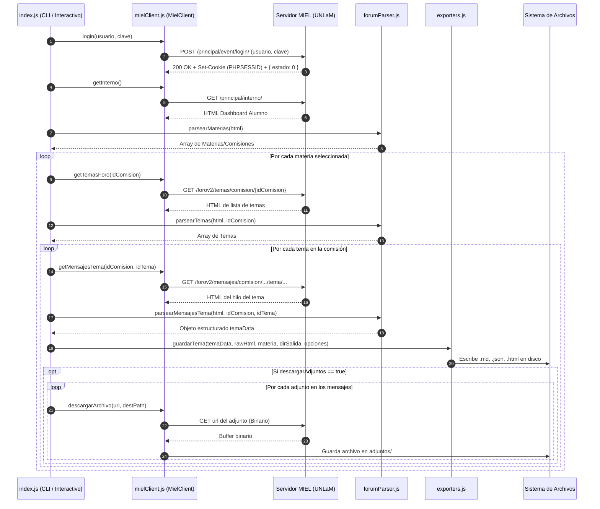

# Documentación Técnica del Proyecto — Guía de Arquitectura para IAs y Agentes LLM

> **Nota para IAs / Modelos de Lenguaje:** Este documento describe la arquitectura, flujo de ejecución, protocolo de red, esquemas de datos y directrices operativas del repositorio `ExtraerForosMiel`. Su objetivo es proporcionar todo el contexto necesario para que un agente autónomo o LLM pueda analizar, modificar, extender el código o procesar los datos extraídos para tareas de RAG (Retrieval-Augmented Generation) y asistencia académica.

---

## 1. Ficha Técnica del Proyecto

- **Nombre:** `extraer-foros-miel`
- **Lenguaje / Entorno:** JavaScript (Node.js >= 18.0.0, módulos CommonJS `require`).
- **Dependencias externas:** **0 (Cero)**. Utiliza exclusivamente las APIs nativas de Node.js (`https`, `http`, `fs`, `path`, `readline`, `buffer`, `url`).
- **Dominio:** Scraping, parsing HTML, serialización de datos y archivado de foros de debate de la plataforma educativa **MIEL** (Materias Interactivas en Línea) de la **Universidad Nacional de La Matanza (UNLaM)**.
- **Salidas generadas:** Markdown (`.md`), JSON estructurado (`.json`), HTML offline (`.html`) y archivos binarios descargados (PDFs, imágenes PNG/JPG en carpeta `adjuntos/`).

---

## 2. Propósito y Valor para Modelos de Lenguaje

Los foros de MIEL contienen consultas de alumnos sobre ejercicios prácticos, respuestas detalladas de docentes y correcciones de exámenes. Sin embargo:
1. Están protegidos tras inicio de sesión web con sesión PHP (`PHPSESSID`).
2. El HTML de la plataforma contiene abundante ruido de maquetación (tablas, estilos en línea, clases CSS de W3.CSS, wrappers visuales).
3. Entregar dicho HTML directamente a un LLM causaría un consumo excesivo de tokens y pérdida de contexto.

Este proyecto resuelve ese problema convirtiendo los hilos de discusión en:
- **Markdown estructurado**: Reduce en más de un 90% el tamaño en tokens manteniendo intacta la semántica, fecha, autor, rol (Docente vs. Alumno) y jerarquía de respuesta mediante bloques de cita (`>`).
- **JSON estandarizado**: Ideal para pipelines de ingesta RAG, fragmentación (chunking), generación de embeddings y filtrado por metadatos.
- **Adjuntos locales**: Descarga automática de enunciados, fotos de pizarrones o resoluciones en PDF referenciados directamente en los textos.

---

## 3. Arquitectura del Código y Responsabilidad de Módulos

```
ExtraerForosMiel/
├── index.js           # Orquestador del ciclo de vida, CLI y modo interactivo (readline)
├── mielClient.js      # Cliente HTTP nativo, manejo de sesiones/cookies y peticiones
├── forumParser.js     # Motor de parsing de HTML a estructuras de datos y Markdown
├── exporters.js       # Serializadores a disco (Markdown, JSON, HTML)
├── package.json       # Definición del paquete y scripts npm (sin dependencias externas)
├── .env.example       # Plantilla de variables de entorno (usuario, contraseña, directorio)
└── README.md          # Documentación orientada al usuario final
```

### 3.1. `mielClient.js` — Cliente de Red y Autenticación
- **Clase `MielClient`**:
  - `cookies`: Almacén de cookies en memoria usando `Map()`. Extrae cabeceras `set-cookie` de cada respuesta HTTP y las adjunta en solicitudes posteriores.
  - `request(urlStr, options)`: Wrapper sobre `https.request` y `http.request`.
    - Agrega User-Agent realista de navegador de escritorio.
    - Maneja redirecciones automáticas (códigos `301`, `302`, `303`, `307`, `308`).
    - Soporta modo binario (`options.isBinary: true`) retornando un `Buffer`.
  - `login(usuario, clave)`:
    - Realiza `POST` a `https://miel.unlam.edu.ar/principal/event/login/`.
    - Codificación: `application/x-www-form-urlencoded`.
    - Espera respuesta JSON con `{ "estado": 0 }`.
  - `getInterno()`: `GET` a `/principal/interno/` (panel del alumno, lista de comisiones inscriptas).
  - `getTemasForo(idComision)`: `GET` a `/forov2/temas/comision/{idComision}`.
  - `getMensajesTema(idComision, idTema)`: `GET` a `/forov2/mensajes/comision/{idComision}/tema/{idTema}`.
  - `descargarArchivo(url, destPath)`: Descarga binaria con escritura atómica/buffer en disco local.
- **Función auxiliar `cargarEnv()`**:
  - Implementación ligera y nativa de lectura de archivo `.env` línea por línea.
  - Evita necesitar la dependencia externa `dotenv`.

### 3.2. `forumParser.js` — Motor de Extracción y Transformación
- **`parsearMaterias(html)`**:
  - Parsea los bloques `<div ... materia-bloque ...>` del panel interno.
  - Extrae `idComision`, nombre de la materia y código de comisión (ej. `01-2900`).
- **`parsearNombreUsuario(html)`**:
  - Extrae el nombre completo del alumno autenticado desde `.nombreUsuario`.
- **`parsearTemas(html, idComision)`**:
  - Parsea los temas de debate de la comisión desde `.foro-tema` o fallback a menú lateral.
  - Extrae `idTema`, `titulo`, `descripcion`, `cantidadMensajes`, `ultimoMensajeFecha` y `url`.
- **`parsearMensajesTema(html, idComision, idTema)`**:
  - Extrae la lista secuencial de mensajes desde etiquetas `<li class="foro-mensaje | foro-respuesta" data-idMensajePadre="..." id="idMensaje-...">`.
  - Determina relación padre-hijo (`parentId`, `esRespuesta`).
  - Extrae autor y rol (`Docente`, `Tutor`, `Alumno`).
  - Convierte el HTML del cuerpo en Markdown limpio con `htmlToMarkdown()`.
  - Detecta imágenes adjuntas (`.foroImgAdjuntos`) y enlaces de descarga de archivos (`/forov2/event/descargar/...`).
- **`htmlToMarkdown(html)`**:
  - Limpia tags HTML redundantes.
  - Convierte párrafos, saltos de línea, negritas, cursivas, subíndices, superíndices, listas y enlaces.
  - Decodifica entidades HTML tanto nominales (`&aacute;`, `&hellip;`) como numéricas (`&#...;`, `&#x...;`).
- **`sanitizarNombre(str)`**:
  - Remueve caracteres ilegales para sistemas de archivos (`\`, `/`, `:`, `*`, `?`, `"`, `<`, `>`, `|`) asegurando compatibilidad cruzada entre Linux, macOS y Windows.

### 3.3. `exporters.js` — Generación de Salidas
- **`generarMarkdown(temaData, materiaInfo, tieneAdjuntosLocales)`**:
  - Construye el archivo `.md`.
  - Encabezado con metadatos: `# Tema: ...`, Materia, Comisión, IDs y Fecha de extracción.
  - Mensajes principales: encabezados de nivel 3 `### [Mensaje #ID] Autor (Rol)`.
  - Mensajes de respuesta: formateados con cita Markdown `> #### [Respuesta #ID a #ParentID]` y cuerpo identado con `> ` para una clara comprensión visual y de LLM de los hilos de conversación.
  - Enlaces relativos a archivos guardados en `adjuntos/`.
- **`generarJSON(temaData, materiaInfo)`**:
  - Construye el objeto JSON estructurado con metadatos de materia, tema, fecha ISO y lista de mensajes con sus atributos completos.
- **`guardarTema(temaData, rawHtml, materiaInfo, dirBase, opciones)`**:
  - Crea la jerarquía de carpetas `{dirBase}/{materiaCarpeta}/{temaCarpeta}/`.
  - Escribe los archivos `.md`, `.json` y/o `.html` según los formatos solicitados.

### 3.4. `index.js` — Orquestación y CLI
- `parsearArgs()`: Lee parámetros de línea de comandos (`process.argv`).
- `main()`: Coordina el flujo:
  1. Login en MIEL.
  2. Obtención de materias.
  3. Filtrado por argumento CLI o menú interactivo por terminal (`readline`).
  4. Selección de formatos (`md`, `json`, `html`, `all`).
  5. Iteración sobre cada tema: petición de mensajes -> parsing -> exportación -> descarga de adjuntos.
  6. Resumen de ejecución en consola.

---

## 4. Diagrama de Flujo del Sistema



---

## 5. Especificación de Endpoints HTTP de MIEL

| Endpoint | Método | Content-Type | Parámetros / Payload | Propósito |
| :--- | :--- | :--- | :--- | :--- |
| `https://miel.unlam.edu.ar/principal/event/login/` | `POST` | `application/x-www-form-urlencoded` | `usuario={dni}&clave={pass}` | Autenticación. Retorna JSON `{ estado: 0 }` y cookie de sesión. |
| `https://miel.unlam.edu.ar/principal/interno/` | `GET` | `text/html` | *(Requiere cookie de sesión)* | Panel principal con las comisiones activas del estudiante. |
| `https://miel.unlam.edu.ar/forov2/temas/comision/{idComision}` | `GET` | `text/html` | `{idComision}` en ruta | Lista de temas de discusión en el foro de la comisión. |
| `https://miel.unlam.edu.ar/forov2/mensajes/comision/{idComision}/tema/{idTema}` | `GET` | `text/html` | `{idComision}`, `{idTema}` en ruta | Hilo completo de mensajes y respuestas de un tema. |
| `https://miel.unlam.edu.ar/forov2/event/descargar/{idArchivo}` | `GET` | Binario / Octet-stream | URL embebida en enlaces | Descarga de documentos adjuntos (PDF, ZIP, DOCX, imágenes). |

---

## 6. Esquemas de Datos

### 6.1. Esquema JSON de Salida (`<tema>.json`)

El archivo generado por `generarJSON()` sigue esta especificación TypeScript / JSON Schema:

```typescript
interface ExportacionTemaJSON {
  /** Nombre formal de la asignatura */
  materia: string;
  /** Código identificador de la comisión (ej. "01-2900") */
  codigoComision: string;
  /** ID numérico de la comisión en MIEL */
  idComision: string;
  /** ID numérico del tema en el foro */
  idTema: string;
  /** Título del tema de debate */
  tituloTema: string;
  /** Timestamp ISO 8601 de la extracción */
  extraidoEn: string;
  /** Cantidad total de mensajes incluidos */
  totalMensajes: number;
  /** Lista cronológica de intervenciones en el hilo */
  mensajes: MensajeJSON[];
}

interface MensajeJSON {
  /** ID único del mensaje en MIEL */
  id: string;
  /** ID del mensaje al que responde (o ID del mensaje padre) */
  parentId: string;
  /** true si es una respuesta anidada; false si abre el hilo */
  esRespuesta: boolean;
  /** Nombre y apellido del autor */
  autor: string;
  /** Rol institucional: 'Docente', 'Tutor', 'Alumno', o '' */
  rol: string;
  /** Fecha y hora textual provista por MIEL (ej. "14/08/2024 18:32") */
  fecha: string;
  /** Contenido del mensaje convertido a Markdown limpio */
  contenido: string;
  /** Lista de recursos descargables anexos al mensaje */
  adjuntos: AdjuntoJSON[];
}

interface AdjuntoJSON {
  /** Tipo de recurso: 'imagen' | 'archivo' */
  tipo: "imagen" | "archivo";
  /** Nombre sanitizado del archivo */
  nombreArchivo: string;
  /** URL absoluta original en los servidores de MIEL */
  urlOriginal: string;
  /** Ruta relativa al archivo descargado localmente */
  rutaLocal: string;
}
```

### 6.2. Convención del Formato Markdown (`<tema>.md`)

El formato `.md` está optimizado para consumo directo de LLMs sin preprocesamiento:

1. **Cabecera de Metadatos:**
   ```markdown
   # Tema: Nombre del Tema
   - **Materia:** MATERIA (Comisión XX-XXXX)
   - **Comisión ID:** 117919
   - **Tema ID:** 45210
   - **Total de Mensajes:** 12
   - **Fecha de Extracción:** DD/MM/AAAA, HH:mm:ss
   ---
   ```
2. **Mensaje Raíz (Pregunta o Apertura del Docente):**
   ```markdown
   ### [Mensaje #101] Juan Pérez (Alumno)
   *Fecha: 10/05/2024 15:30*

   Hola profesor, tengo una duda con el ejercicio 4 de la guía...
   ---
   ```
3. **Respuesta Anidada (Resolución del Docente):**
   ```markdown
   > #### [Respuesta #102 a #101] Dr. Carlos González (Docente)
   > *Fecha: 10/05/2024 16:15*
   >
   > Para resolver el ejercicio 4 debes aplicar el Teorema Central del Límite...
   >
   > **Adjuntos:**
   > - [resolucion_ejercicio4.pdf](adjuntos/resolucion_ejercicio4.pdf)
   ```

---

## 7. Variables de Entorno y Argumentos CLI

### 7.1. Variables en `.env`

| Variable | Tipo | Obligatoria | Descripción |
| :--- | :--- | :--- | :--- |
| `MIEL_USUARIO` | string | Sí (o por `-u`) | DNI o identificador de usuario para acceder a MIEL. |
| `MIEL_PASSWORD` | string | Sí (o por `-p`) | Contraseña del usuario en MIEL. |
| `OUTPUT_DIR` | string | No (default: `resultados`) | Carpeta raíz donde se almacenarán las exportaciones. |

### 7.2. Opciones de Línea de Comandos (`node index.js [opciones]`)

| Flag | Alias | Tipo | Valor por defecto | Descripción |
| :--- | :--- | :--- | :--- | :--- |
| `--all` | `-a` | boolean | `false` | Descarga todos los foros de todas las materias sin prompts. |
| `--materia` | `-m` | string | `null` | Filtra por nombre de materia o `idComision`. |
| `--tema` | `-t` | string | `null` | Filtra por título de tema o `idTema`. |
| `--format` | `-f` | string | `md,json,html` | Formatos separados por coma: `md`, `json`, `html`, `all`. |
| `--output` | `-o` | string | `resultados` | Directorio de destino. |
| `--attachments` | — | boolean | `true` | Descarga los archivos e imágenes adjuntas. |
| `--no-attachments` | — | boolean | `false` | Omite la descarga de adjuntos binarios. |
| `--user` | `-u` | string | `null` | Usuario MIEL (prioritario sobre `.env`). |
| `--pass` | `-p` | string | `null` | Contraseña MIEL (prioritaria sobre `.env`). |
| `--help` | `-h` | boolean | `false` | Imprime la ayuda en consola y finaliza. |

---

## 8. Guía para Sistemas RAG e Ingesta por Agentes IA

Cuando una IA procese los datos generados por este repositorio para armar un asistente de estudio o base de conocimiento:

1. **Priorización por Rol:**
   - En el archivo `.json`, las entradas con `rol: "Docente"` o `rol: "Tutor"` representan respuestas autorizadas y canónicas. Se les debe asignar mayor ponderación o peso de relevancia en la fase de reranking o recuperación.
2. **Reconstrucción del Hilo Conversacional:**
   - Al fragmentar (chunking), **no separar** los mensajes de tipo `esRespuesta: true` de su mensaje padre `parentId`. Una respuesta como *"Sí, da 0.05"* carece de sentido sin la consulta original del alumno.
   - El archivo `.md` ya agrupa naturalmente la conversación con el prefijo `>`, lo que facilita la ingesta de hilos completos en ventanas de contexto medianas o grandes (ej. Gemini 1.5/2.0, GPT-4, Claude 3.5).
3. **Referencias a Adjuntos:**
   - Si el mensaje contiene enlaces en `adjuntos/` (ej. diagramas o enunciados en PDF), un agente multimodal puede leer directamente las imágenes locales o extraer texto del PDF correspondiente para enriquecer el chunk de información.

---

## 9. Directrices para Asistentes de Código IA que Modifiquen este Proyecto

Si un agente de desarrollo (como Antigravity, Copilot, Cursor, etc.) recibe instrucciones para modificar o extender este proyecto, debe respetar las siguientes reglas de diseño:

1. **Política Estricta de Cero Dependencias Externas:**
   - No añadir librerías npm (como `axios`, `cheerio`, `dotenv`, `puppeteer`, `express`) a menos que el usuario lo solicite explícitamente.
   - Todo debe implementarse usando módulos nativos de Node.js.
2. **Robustez ante Variaciones del HTML:**
   - La plataforma MIEL usa templates PHP que pueden variar sutilmente entre comisiones o cuatrimestres. Las expresiones regulares en `forumParser.js` deben ser permisivas con espacios en blanco (`\s*`), orden de atributos HTML y entidades escapadas.
3. **Sanitización de Nombres de Archivo y Carpetas:**
   - Siempre pasar nombres de materias, comisiones y temas por `sanitizarNombre()` antes de crear carpetas o archivos en disco para prevenir errores en sistemas de archivos Windows o Linux.
4. **Manejo de Tiempos de Red y Concurrencia:**
   - El script procesa temas de manera secuencial para evitar disparar bloqueos o límites de tasa (rate-limiting) en los servidores institucionales de la UNLaM. Si se implementa concurrencia, usar límites controlados (ej. `p-limit` nativo con un pool pequeño de promesas).
